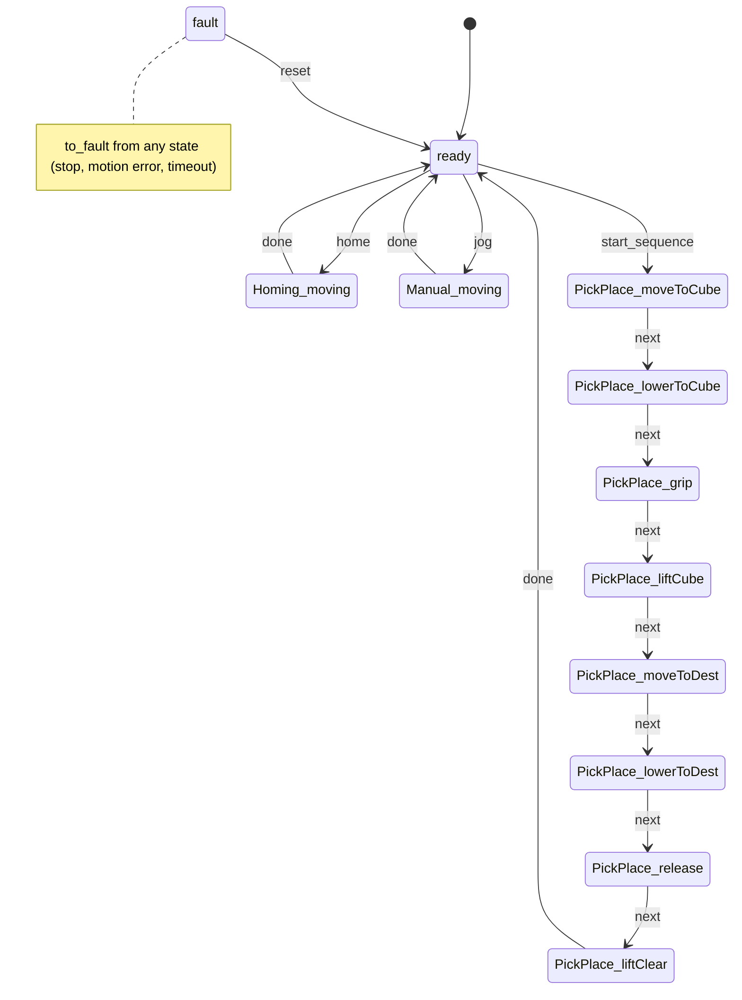

# **Robot Pick & Place Simulation**

A proof-of-concept for a 3-axis gantry cell:
- a **Python backend** (FastAPI, `vention-communication`, `vention-state-machine`, `vention-storage`) that drives the provided `robot_sim.Robot` through a state machine;
- a **React + TypeScript dashboard** that shows live telemetry and lets you configure and run the pick-and-place sequence.

The original exercise statement is [at the end of this file](#exercise-statement), with the checklist ticked.

**Demo video:** [docs/Demo.mp4](docs/Demo.mp4). It shows a manual move and Home, config validation, a full pick-and-place cycle, Stop and Reset after a fault, persistence across a restart, and the test run. GitHub may not play a file this size in the browser; use "View raw" to download it.

- [Run with Docker (one command)](#run-with-docker-one-command)
- [Setup and run (without Docker)](#setup-and-run)
- [Project structure](#project-structure)
- [Architecture](#architecture)
- [Design decisions](#design-decisions)
- [Assumptions](#assumptions)
- [Trade-offs and known limitations](#trade-offs-and-known-limitations)

---

## Run with Docker (one command)

With [Docker Desktop](https://www.docker.com/products/docker-desktop/) (or Docker Engine with Compose) running, from this folder:

```bash
docker compose up --build
```

Open **http://localhost:8080**. The first build downloads the base images and takes a few minutes; later builds are cached.

- **backend** is the FastAPI app (`python:3.10-slim`). Its database lives on the named volume `gantry-data`, so the configuration and robot state survive `docker compose down` / `up`.
- **frontend** is the dashboard, built with Node and served by nginx. nginx also forwards `/rpc/` to the backend, so the browser talks to a single origin, and response buffering is off so the telemetry stream flows in real time.
- Stop with Ctrl+C, or `docker compose down` if started with `-d`. `docker compose down -v` also deletes the volume, resetting the saved configuration and robot state.

---

## Setup and run

### Prerequisites

- **Python 3.10.** All three `vention-*` libraries declare `Requires-Python >=3.10,<3.11`, so pip refuses to install them on 3.11+.
- **Node.js 18+.** Vite 6 needs Node 18, 20 or 22+; developed with Node 22.

### Backend

From `backend/`:

```bash
# Windows
py -3.10 -m venv venv
venv\Scripts\activate

# macOS / Linux
python3.10 -m venv venv
source venv/bin/activate

pip install -r requirements.txt
uvicorn app.main:app --port 8000
```

- The API is served under `http://localhost:8000/rpc/vention.app.v1.GantryAppService/<action>`.
- At startup the backend writes `proto/app.proto`, the contract the frontend client is generated from. A copy is committed.
- The configuration and the robot's last state are saved in `backend/data/gantry.db` (SQLite, git-ignored). Set `GANTRY_DB_URL` to use another database.

### Frontend

From `frontend/`, with the backend running:

```bash
npm install
npm run dev
```

Open http://localhost:5173.
- `npm run dev` and `npm run build` first regenerate the typed client from `../backend/proto/app.proto` (`npm run gen`, using Buf from `node_modules`; nothing global to install).
- The backend URL defaults to `http://localhost:8000/rpc`. Override it with `VITE_API_URL`, e.g. in `frontend/.env.local`.

### Tests

```bash
# backend/, with the venv active: 75 tests, about 4 s
python -m pytest

# frontend/: type check, production build and lint
npm run build
npm run lint
```

---

## Project structure

```
docker-compose.yml      whole stack: backend + frontend (nginx) + data volume
backend/
  Dockerfile
  robot_sim.py          provided simulator (unchanged)
  app/
    geometry.py         cell layout and table → robot frame transform
    config.py           CellConfig (cube, destination, home, heights, speed) + validation
    robot_driver.py     GantryDriver protocol + RobotDriver: async wrapper around robot_sim
    machine.py          GantryMachine: the vention-state-machine state machine
    config_store.py     persistence with vention-storage (config + robot state)
    api.py              vention-communication actions and telemetry stream
    main.py             app assembly: startup/shutdown, CORS, proto emission
  tests/                pytest: geometry, driver, machine, API (+ fake drivers)
  proto/app.proto       generated API contract
frontend/
  Dockerfile, nginx.conf  build with Node, serve with nginx, proxy /rpc to the backend
  buf.gen.yaml          client code generation from the proto
  src/
    api/                Connect client, useTelemetry (live stream), useConfig
    model/              geometry mirror, state labels and allowed commands
    components/         TopView, ZGauge, TelemetryPanel, Controls, ConfigForm, JogForm, Banners
    App.tsx             dashboard layout and wiring
```

---

## Architecture

```
React dashboard ──Connect (JSON over HTTP)──▶ api.py actions ──▶ GantryMachine ──▶ RobotDriver ──▶ robot_sim.Robot
        ▲                                                            │
        └──── telemetry stream (~20 Hz) ◀── machine.status() ◀───────┘
                                                                     │ after every transition
                                          config_store.py (SQLite) ◀─┘
```

### State machine



- **Each motion state's enter callback starts a background task.** The task polls `robot_sim.move_to` until the target is reached (inside the state machine callbacks, as the exercise asks), then fires `next` or `done`.
- **A motion error, a timeout or the Stop button** fires `to_fault`. That cancels the running motion and shows the reason on the dashboard; `reset` returns to `ready`.

### API

| Action | Purpose |
|---|---|
| `get_config` / `set_config` | Cube start (Table A frame), destination (Table B frame), home, travel/pick heights, speed. `set_config` validates and saves. |
| `get_robot_position` / `move_robot` | Read / set the robot position (a jog). |
| `home_robot`, `start_sequence`, `stop`, `reset_fault` | Commands. |
| `get_status` | One-off status snapshot. |
| `telemetry` (stream) | Status about 20 times per second: state, position, gripper, moving, cube, destination, error. |

Commands return `{ok, error}`. A refused command (e.g. Start while busy) comes back as `ok: false` with a readable reason, shown in the UI.

---

## Design decisions

**Wrapping the simulator instead of changing it.** `RobotDriver` (`robot_driver.py`) handles `robot_sim.Robot`'s quirks:
- `move_to` is non-blocking and must be polled: an `async move()` polls every 20 ms with `asyncio.sleep`, so the server stays responsive.
- Errors are returned as strings, not raised: they become a `MotionError`.
- Speed 0 passes validation but divides by zero: speeds must be 1–100.
- The caller's list becomes the robot's position (aliasing), and constructor defaults are shared mutable lists: lists are always copied.
- An interrupted move leaves a stale `axis_speed` that skews the next one: it's reset before each move and in a `finally` (also on cancellation).

`move_home()` isn't used: it calls `move_to` only once. Homing reuses `move()`.

**The driver is injected behind a protocol.** `GantryMachine` takes a `GantryDriver` (a `typing.Protocol`), and `main.py` passes `RobotDriver()`. Tests pass instant fake drivers, and a real-hardware driver could be swapped in without changing the state machine.

**State machine design** (`machine.py`):
- Hooks start background tasks and return immediately: the library calls them synchronously, and blocking there would freeze the server.
- Every motion has a timeout based on its distance and speed.
- Guards make the machine itself refuse invalid transitions (invalid config, robot still moving). The command methods also return friendly messages.
- Homing and the first sequence move **lift to travel height before moving in X/Y**, so the gripper is never dragged across a table.
- **Last-state recovery is disabled:** after a restart the machine starts in `ready`, never mid-motion.

**Coordinate frames.** Cube and destination are entered in their **table's own frame** (0–500 mm from the red reference corner in Figure 1), and `geometry.py` converts them to the robot frame. Validation ("is it on the table?") is then a simple square check, even for the rotated Table B.

**Persistence** (`config_store.py`):
- The configuration and the robot's **last known state** (position, gripper, simulated cube) are saved with `vention-storage`. The state is saved after every state transition and at shutdown, and restored at startup. The robot doesn't "teleport" back to the origin after a restart.
- **`storage.bootstrap()` isn't used:** it always mounts REST CRUD endpoints for each model (and a `/db` backup/restore router). Those would let clients change the configuration without validation and while the machine is running. The lower-level pieces (`set_database_url`, `get_engine`, `ModelAccessor`) keep `set_config` as the only way in, and still record changes in the library's audit log.

**API design** (`api.py`):
- Actions never raise for expected refusals. They return `CommandResult`, because the library turns exceptions into HTTP 200 responses with an `error` body.
- Request fields default to their **proto3 zero values**, because protobuf JSON omits default-valued fields (the browser sends `"home": {}` for (0, 0, 0)).
- Positions are nested `Point2` / `Point3` messages, since tuples don't map to proto types.
- The handlers are module-level functions (the library registers them at import) that reach the machine through one small `runtime` holder.

**Frontend:**
- The TypeScript client is **generated from the backend's proto** (protobuf-es / Connect v2), so the API is typed end to end.
- `useTelemetry` keeps the stream alive: it reconnects after errors and after 2 s of silence, and keeps the last data visible, greyed out, while disconnected.
- Buttons are enabled from the same rules the backend enforces, so impossible actions aren't offered; the backend remains the authority.
- The config form previews unsaved positions on the drawing and never overwrites the user's edits with incoming updates.
- Plain CSS, light and dark mode, responsive layout.

---

## Assumptions

- **Cell layout.** The exercise gives the footprint (2 m × 2 m) and table size (0.5 m) but not where the tables are. I used round values that resemble Figure 1: robot origin at the footprint centre; **Table A** at (−900, 400) mm, 100 mm from the left and top edges, not rotated; **Table B** at (250, −550) mm, rotated −45°. They're constants in `backend/app/geometry.py`, mirrored in `frontend/src/model/geometry.ts`.
- **Z.** Home `z = 0` is the travel height, and the cube is picked and placed at a configurable `pick_z` (default −300 mm). Both are configurable, with pick below travel.
- **One cube, put back between runs.** Each Start assumes the cube is at its configured start position: the simulated cube is placed back on Table A when a sequence starts.
- **Gripper timing.** The simulated gripper acts instantly. The machine waits 0.3 s on grip and release, to look realistic.
- **Stop is a fault.** Stop halts motion immediately by going to `fault`, and requires a Reset. There is no "pause and resume".

---

## Trade-offs and known limitations

- **A restart clears an unacknowledged fault.** The machine always restarts in `ready`; persisting the fault and requiring Reset would be stricter.
- **A hard kill mid-move.** If the backend process is killed during a move, the saved position is where that move started. A Stop through the app, or a normal shutdown, saves the exact position. A real gantry would read its encoders or home at startup.
- **The table constants exist in both Python and TypeScript.** A `get_layout` action would remove the duplication.
- **Telemetry is polled and published at about 20 Hz** (about 17 Hz measured on Windows), not pushed on every change. That's simple and plenty for a dashboard.
- **Robot state saves are audited.** Each save adds a small audit-log row (about 10 per cycle); a long-running cell would prune them.
- **The vention libraries are pinned to Python 3.10** and are thinly documented. I read their source to confirm several behaviours: the library's own `to_fault` cleanup is never awaited (so the machine cancels its tasks itself), state names can't contain underscores, responses are snake_case while requests also accept camelCase, and stream queues bind to the first event loop.
- **Not done:** frontend component tests (Vitest); the backend tests cover the logic.

---

<a id="exercise-statement"></a>

## **Problem Statement**

You are tasked with building a proof-of-concept for a 3-axis gantry robot solution. The goal is to implement a Python backend that controls a robotic arm using a State Machine and a React frontend to visualize and configure the operation.

You must simulate a "Pick and Place" sequence: picking a cube from **Table A** and placing it on **Table B** within the provided application footprint.


## **Checklist of Requirements**

### **Mandatory Requirements**

**Backend (Python & FastAPI)**

  - [x] **Communication Framework:** Use the [`vention-communication`](https://pypi.org/project/vention-communication/) library to establish communication between the frontend and backend.
  - [x] **State Machine Integration:** Implement the robot's control logic using the [`vention-state-machine`](https://pypi.org/project/vention-state-machine/) library.
  - [x] **Robot Simulation:** Interface with the provided `robot_sim.py` class.
      - *Note:* The `move_to` method must be called repeatedly until motion is complete. This should be handled inside your state machine callbacks.
  - [x] **API Endpoints:** Create endpoints to:
      - Get/Set robot, cube, and destination positions.
      - specific commands: `Home Robot`, `Start Sequence`, `Get Status`.
      - *Note:* The "Home" operation moves the robot to its home position (default: `[0, 0, 0]`). Review `robot_sim.py` to understand the `move_home()` method and the `home_position` parameter.
  - [x] **Logic:** Implement the full Pick-and-Place sequence:
    1.  Move to Cube (Table A) $\rightarrow$ Lower $\rightarrow$ Close Gripper.
    2.  Lift $\rightarrow$ Move to Destination (Table B).
    3.  Lower $\rightarrow$ Open Gripper $\rightarrow$ Lift.

**Frontend (React & TypeScript)**

  - [x] **Dashboard:** Display real-time telemetry:
      - Current Robot Position (X, Y, Z).
      - Cube Start Position & Destination.
      - Robot Status (Gripper open/closed, moving/idle).
      - Current State of the State Machine.
  - [x] **Controls:** Allow the user to:
      - Configure the Cube's start coordinates and destination coordinates.
      - Trigger the "Home" operation (moves robot to home position, default: `[0, 0, 0]`).
      - Start the "Pick and Place" sequence.
  - [x] **Visuals:** Provide a clear visual indication of errors and operational state.

### **Bonus Points**

  - [x] **Persistence:** Use [`vention-storage`](https://pypi.org/project/vention-storage/) to save configuration (e.g., cube locations) between restarts.
  - [x] **Testing:** Write unit tests for the backend logic or component tests for the frontend.
  - [x] **Containerization:** Run the whole stack (Backend + Frontend) with a single command (e.g., Docker Compose).
  - [x] **Demo:** Include a short video recording of your solution in action. See [docs/Demo.mp4](docs/Demo.mp4).

## **Technical Resources**

**Backend Setup**

```bash
cd backend
python -m venv venv
source venv/bin/activate
pip install -r requirements.txt
# Requirements include: fastapi, vention-communication==0.3.0, vention-state-machine==0.3.1, vention-storage==0.5.4
```

**Frontend Setup**

```bash
cd frontend
npm install
npm run dev
```

## **Submission**

  - [x] Fork the repository and complete the work in your fork.
  - [x] Include a **README** documenting:
      - Setup and run instructions.
      - Design decisions, assumptions, and trade-offs.
  - [x] Push your changes and share the repository link.

-----

### **Questions?**

If you have any questions about the exercise, please contact [isaac.mills@vention.cc](mailto:isaac.mills@vention.cc). Happy coding\!
